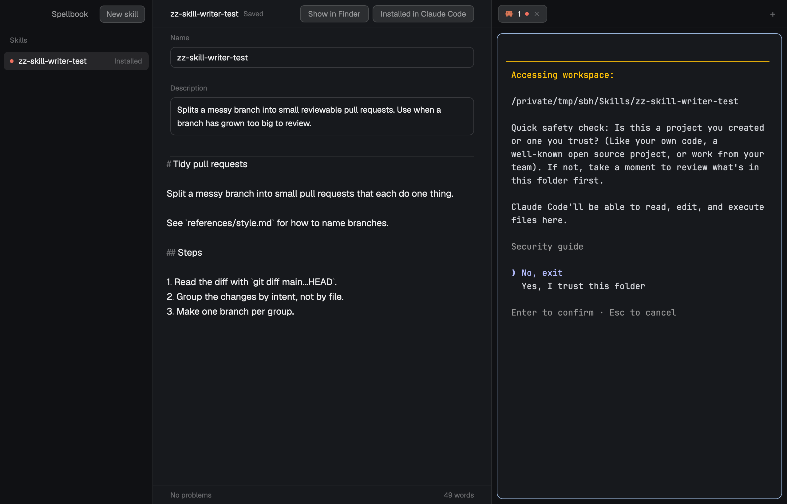

# Spellbook

A window for writing agent skills with Claude Code beside you. Your skills are listed on the left, the open skill's name, description and body are in the middle with lint as you type, and the skill's own Claude Code session is on the right, working in the skill's folder.

## What you see

- **Left, 248px, `chrome`.** A 46px strip with "Spellbook" (13px, `muted`) after the traffic lights and a New skill button. Under it, 11.5px `dim` "Skills", then one 30px row per skill in the skills folder (default `~/Skills`), newest `SKILL.md` first: a 6px status dot, the name (`foreground` when shown, else `muted`), and on the right "Installed" (`dim`) or "Changed since install" (`ansi3`). The shown skill's row is `selected`.
- **Middle, the rest, `background`.** A 46px header with the skill's name, "Saved", "Saving…" or "Unsaved" (`dim`), and buttons Show in Finder and Install in Claude Code (`solid`; quiet "Installed in Claude Code" once current). Then Name (34px input) and Description (textarea, 2 to 6 rows), each with its lint message under it (`ansi1` error, `ansi3` warning) and a character count past 800. Then a rule, and the body in Herdr's editor: markdown, Geist 15px, soft wrap, no line numbers, at most 760px wide and centred. A 30px footer: problem count, the first body problem with its line, and the word count.
- **Right, 480px, `chrome`.** Herdr's `tabs` mod over the shown tab's terminals, framed as cards: the skill's Claude Code.

## How it behaves

- Clicking a skill shows its space, or makes one: named after the skill, in its folder, running `claude --append-system-prompt <prompt.md>`. Each skill keeps its own agent and conversation.
- The status dot is the space's agent status: `working`, `blocked` or `done` in their theme colours, nothing when idle.
- Editing a field rewrites only that frontmatter key (comments and other keys kept). The editor holds only the body; the frontmatter and the blank lines after it are kept aside and joined back on save.
- Autosave 600ms after the last change, writing only if the file still matches what was last read. If it doesn't, a bar offers Reload or Keep mine.
- A change on disk (the agent's) with no unsaved edits replaces the text at once and shows "SKILL.md was changed outside the editor" with Revert and Keep.
- New skill opens a dialog: a name (checked as you type: lowercase, hyphens, 64 at most, not taken) and an optional "What should it do?". Make skill creates the folder and a frontmatter-only `SKILL.md`, opens it, and sends the sentence to Claude as its first message.
- Install copies the folder to `~/.claude/skills/<name>` with `rsync --delete`. If the installed copy differs, Herdr's `confirm` dialog asks first.

## Built from

- `layouts/spellbook.json`: a row of the sidebar column (brand block with `window_drag`, library block), the skill block, and the agent column (`tabs` block with `window_drag`, then `{ "tab": "active" }` with a card frame).
- One mod, `spellbook`, three views by `props.view`: `library` (with `part: "brand"` for the strip), `skill`, and `new` (opened as a dialog overlay).
- `core.js`: Spellbook's lint and frontmatter code (TypeScript, with the `yaml` package), bundled with `bun build`. Source in `src/core`.
- `herdr`: `spaces`, `exec` (`sh`, `find`, `diff`, `rsync`, `open`), `readTextFile`, `writeTextFile` with `expected`, `watchFolder`, `openOverlay`, `notify`, `shared` / `setShared` (`spellbook.installed`, so every copy rechecks installs), `nextCommand` (`spellbook.install` from the confirm dialog), `run` (`space.select`, `space.new`).
- Settings in `spellbook.json` in Herdr's home: `root`, `claude`, `agent`, `font`.

## Watch out

- A skill's space is found by its folder, so a space made elsewhere in a skill's folder counts as that skill's.
- `EditorState` has no inline diagnostics, so lint is shown under the fields and in the footer, not in the text.
- Herdr doesn't hot-reload a symlinked mod; switch layouts to load changes.
- Install compares folders with `diff -rq`, so it can't tell an edited draft from an edited installed copy; both read "Changed since install".
- Only `SKILL.md` is editable here; other files are for the agent.
- macOS first: `stat -f` with a `stat -c` fallback, and Show in Finder uses `open`.

## Done when

- `herdr-app check mods/spellbook` passes and `bun test` passes.
- With a skill in `~/Skills`, the sidebar lists it, and clicking it opens a space running Claude Code in its folder.
- A description starting with "I " shows the third-person warning under the field.
- Editing `SKILL.md` from a terminal updates the editor within a second and shows Revert.
- Install makes `~/.claude/skills/<name>` identical to the draft, and the row says Installed.
